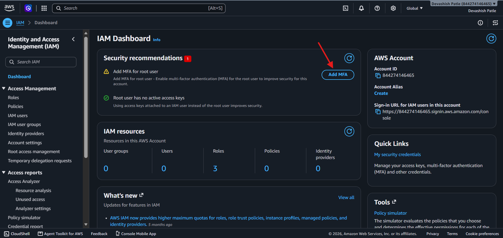
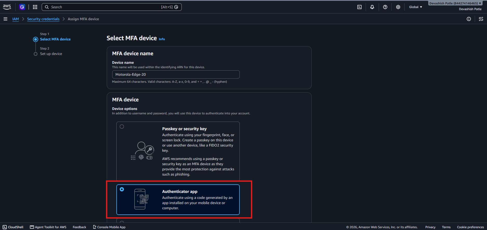
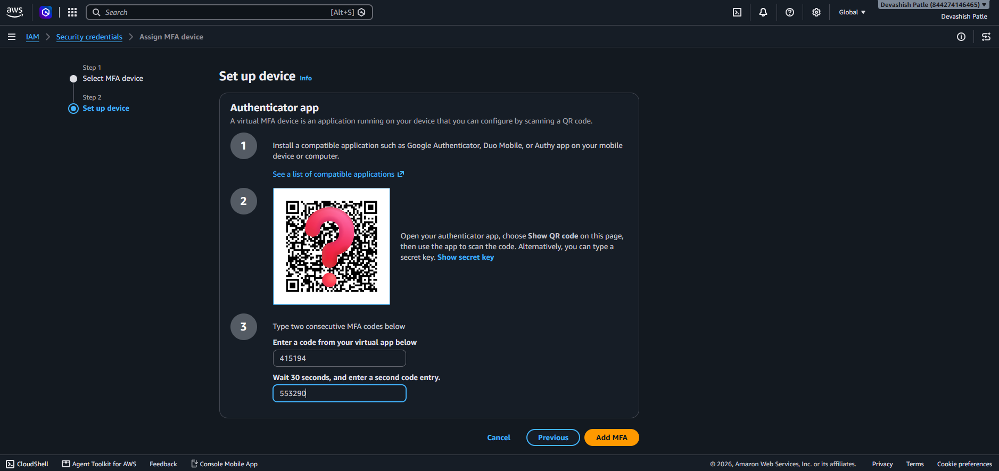
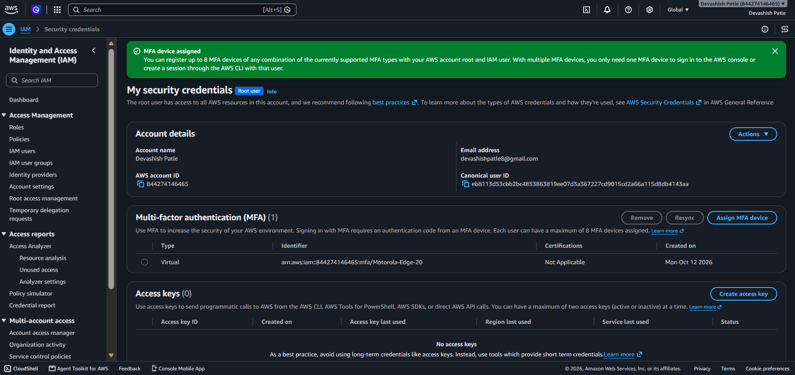

# AWS-IAM-Root-User-Multi-Factor-Authentication-MFA
Hands-on AWS IAM security project demonstrating root user Multi-Factor Authentication (MFA) setup using a virtual authenticator app, device enrollment, verification, and security best practices.

## 📌 Project Overview

This project demonstrates how to improve AWS account security by enabling Multi-Factor Authentication (MFA) for the AWS root user using a virtual authenticator application.

MFA adds an additional authentication factor to help protect an AWS account from unauthorized access.

## 🎯 Objectives

- 🔐 Understand AWS Identity and Access Management (IAM).
- 🛡️ Configure MFA for the AWS root user.
- 📱 Set up a virtual authenticator application.
- 🔑 Verify and assign an MFA device.
- 📸 Document the implementation with screenshots.
- 📚 Follow cloud security best practices.

## 🧰 Tools and Technologies

| Tool | Purpose |
|---|---|
| ☁️ Amazon Web Services | Cloud platform |
| 🔐 AWS IAM | Identity and access management |
| 📱 Authenticator App | Generate TOTP codes |
| 🌐 AWS Console | Configure MFA |
| 🐙 GitHub | Project documentation |
| 📝 Markdown | README documentation |

## 🏗️ Project Workflow

```text
AWS Management Console
          |
          v
     Open AWS IAM
          |
          v
 Review MFA Recommendation
          |
          v
 Select MFA Device
          |
          v
 Choose Authenticator App
          |
          v
 Scan QR Code and Verify
          |
          v
 Assign MFA Device
          |
          v
 Verify Successful Assignment
```

## ⚙️ Step-by-Step Implementation

### 📸 Step 1: Open AWS IAM Dashboard

**Objective:** Locate the MFA security recommendation.

1. Sign in to the AWS Management Console.
2. Search for IAM.
3. Open Identity and Access Management.
4. Review the security recommendations.
5. Click **Add MFA** for the root user.



**Result:** The IAM Dashboard displayed the recommendation to enable MFA for the root user.

### 📸 Step 2: Select MFA Device

**Objective:** Choose the authentication method.

1. Open the MFA device assignment workflow.
2. Enter a recognizable device name.
3. Review the available MFA options.
4. Select **Authenticator app**.
5. Continue to device setup.



**Result:** The virtual authenticator app option was selected.

### 📸 Step 3: Configure Authenticator App

**Objective:** Register the authenticator with AWS.

1. Open a compatible authenticator app on your phone.
2. Add a new account in the app.
3. Scan the QR code displayed by AWS.
4. Enter the first current verification code.
5. Wait for the next code to appear.
6. Enter the second consecutive code.
7. Submit the codes to verify the device.



**Result:** AWS requested two consecutive codes to validate the authenticator setup.

> ⚠️ Security: Never publish the actual QR code, secret key, password, or MFA verification codes.

### 📸 Step 4: Verify MFA Assignment

**Objective:** Confirm that AWS registered the MFA device.

1. Submit the verification codes.
2. Click **Add MFA**.
3. Wait for the success notification.
4. Open the root user's security credentials.
5. Confirm that the virtual MFA device appears in the list.



**Result:** AWS displayed the successful MFA device assignment notification.

## 🧪 Testing and Results

| Test Case | Expected Result | Status |
|---|---|---|
| IAM Dashboard review | MFA recommendation visible | Completed |
| MFA device selection | Authenticator app selected | Completed |
| Authenticator configuration | Verification codes submitted | Completed |
| MFA device assignment | Success notification displayed | Completed |
